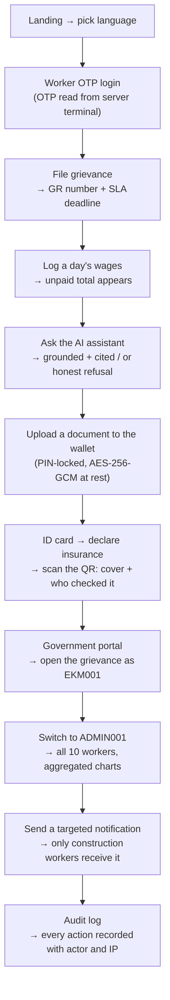

# ShramSetu — Demo / Viva Guide

A worker-facing labour-rights platform: file grievances, log wages,
and ask an AI assistant about welfare schemes **in your own language** — with a
government portal scoped by jurisdiction.

Stack: **React + Vite** (frontend) · **Node.js/Express + MongoDB** (API, auth,
all business logic) · **Python/FastAPI** (RAG, speech) · **LangChain + FAISS +
Groq** (retrieval-grounded answers).

---

## 0. Before you present (5 minutes)

```powershell
# stop anything left over from a previous run
powershell -NoProfile -ExecutionPolicy Bypass -File stop-all.ps1

# start everything and WAIT until the AI service is genuinely ready
powershell -NoProfile -ExecutionPolicy Bypass -File start-all.ps1
```

`start-all.ps1` polls `GET /health/ready`, which returns **503 until the AI
models have finished loading**, so the script blocks until the chatbot can
actually answer. Expect a ~30 s wait on the first run and `[WARM]` if you
interrupted it. It prints which model is still loading:

```
[OK]   API      :8000
[OK]   AI       :8100
[OK]   Frontend :5199
```

**Reset the demo data** so the demo starts from a known state:

```bash
cd server && npm run demo:reset        # asks before deleting; add -- --yes to skip
```

It deletes workers and everything they own (grievances, wage entries,
chat history, notifications, wallet metadata), then re-seeds from the same
seeder the server boot uses. Government officials and the bootstrap admin are
**kept** so logins keep working. It refuses to run when `ENV=production`. With
the default `MONGODB_URI=memory` it tells you to just restart the server — that
dev database is fresh on every boot.

---

## 1. Credentials

Read them out of the `DEV SEED ACCOUNTS` block at the end of
[`server/.env.example`](server/.env.example) — one list, in one file that is
never shipped. They are seeded fixtures, not accounts that can exist in a
production database (see the boot guard in `server/src/config.js`).

The roles you will switch between: **superadmin** (sees everything + audit
logs), **state official** (sees one state), **district official** (sees one
district), **worker** (password tab, or the OTP tab where the code prints only
in the server terminal), **employer** (accepted, has one listing) and
**household**.

Both hiring-side accounts are signed-in surfaces for the same worker list:
search by name, place or trade, read the worker's mobile number, then **Call**
or **SMS** with the buttons on the card. The seeded employer can also post listings;
a newly self-registered employer starts pending and can browse/call but not
post or rate until a labour office accepts it.

**Seeded workers (10).** Ramesh Kumar (construction, Ernakulam) · Sunita Devi
(domestic work) · Md. Imran Sheikh (garment, Kozhikode) · Lakshmi Narayanan
(agriculture, Palakkad) · Rahul Verma (driver) · Anjali Kumari (hospitality) ·
Karthik Rajan (factory, Coimbatore) · Priya Chatterjee (security) · Suresh Yadav
(street vendor) · Meena Kumari (construction, Coimbatore). 11 grievances across
9 categories, each with a seeded status and SLA deadline.

District split: **Ernakulam 3, Kozhikode 1, Palakkad 1, Thrissur 1,
Thiruvananthapuram 2** (Kerala, 8 total) and **Coimbatore 2** (Tamil Nadu).
Good demo pair: **the Ernakulam official sees 3 workers, the superadmin sees
all 10** — that single contrast is the strongest scoping proof you have.

---

## 2. Six-minute demo flow

The flow is built so each step sets up the next: the grievance you file is the
one the official acts on, and the wage shortfall becomes a complaint.



### Step-by-step, with what to say

1. **Landing → language** — pick Hindi. Every page, button and error is
   translated; the AI answers in the worker's language too.

2. **Worker login** — `9555500101` → Continue → read the 6-digit OTP from the
   **server terminal** and type it in. *The website never displays or
   auto-fills the OTP* — say this out loud, it's a real security property, not
   a demo trick. Dashboard shows worker ID `SS-100001` and its QR.
   (Honest caveat if asked: the QR encodes the worker-ID string only. It is an
   identifier display, **not** a verifiable credential.)

3. **File a grievance** — category "Unpaid wages" → gets an auto
   `GR-XXXXXXXX` number, **high** priority (assigned from the category, not
   chosen by the worker: `harassment_abuse`/`workplace_safety` → urgent,
   `unpaid_wages`/`illegal_termination` → high, everything else → medium) and a
   **14-day SLA deadline** from that priority. SLA = `urgent 7 · high 14 ·
   medium 30 · low 45` days.

4. **Wage diary** — log a day with agreed 700 / paid 450 → the month summary
   shows the unpaid total → **"File unpaid wage complaint"** opens the grievance
   form pre-filled (category `unpaid_wages`, amounts in the description).
   Then settle that day (paid = agreed): the entry turns green **and locks** —
   re-saving the same date is refused with "This day is fully paid and can no
   longer be edited" (API answers 409). A settled wage record cannot be
   rewritten after the fact.
   *Entries are self-reported and never verified against an employer — the UI
   says so under the list.*

5. **AI assistant** — two questions, in this order:
   - *"What is the minimum wage and which law fixes it?"* → a **grounded** answer
     citing the **Code on Wages, 2019**, with a sources panel showing the
     official URL and last-verified date, and the "informational only, not legal
     advice" line.
   - *"Who won the cricket match yesterday?"* → an **honest refusal**, not a
     hallucination. This is the single most impressive 10 seconds of the demo:
     retrieval is gated at similarity 0.45, so off-topic questions retrieve
     nothing and the assistant says so.

   Then toggle 🔊 (local MMS TTS) and 🎤 (local Whisper), switch the UI to
   Hindi and ask in Hindi — retrieval still grounds the answer because the
   question is translated to English *before* retrieval.

6. **Document wallet** — set a PIN (4–8 digits; five wrong attempts locks it
   for 5 minutes), upload a PDF, download it back. Files are AES-256-GCM
   encrypted at rest with per-file keys wrapped under `DOC_MASTER_KEY`.
   *The PIN is a convenience screen-lock, not encryption* — say this if asked.

7. **Insurance on the ID card** — open **Worker ID card**. With no policy it
   reads *"No cover on record"*. Add one (insurer, policy number, cover amount,
   dates), and the card immediately reads *"National Insurance Co. · cover
   ₹2,00,000 · valid until 14 Jan 2027"* with the badge **"Declared by worker ·
   not verified"**. Open the QR link in a second window: the same details, the
   policy number masked to `••••9231`, and the line *"Cover declared by the
   worker, not yet checked by an office"*.

   Then go to the government console as **KL001** → **Insurance** tab → **Mark
   verified**. Reload the public page: the badge flips to *"Checked by a labour
   office"*. Try the other direction too — the worker can no longer delete that
   policy (HTTP 409).

   *Say the design rule out loud: status is derived from the dates on every
   read, never stored, so a card printed last week cannot claim cover that
   lapsed yesterday. And the page says whether a claim is paid is the insurer's
   decision — not ours.* The **CSV** button on that tab downloads the register
   for the official's jurisdiction only.

   Then open the **⏰ Overdue** tab. Every complaint here has blown the deadline
   its priority promised, oldest first, each tagged **"District office
   notified"** — the escalation is automatic, not a thing an official has to
   remember, and a restart cannot escalate the same complaint twice. Seven days
   later, or on a backdated row, the same rung moves to **"State office
   notified"**.

8. **Jurisdiction scoping** — log in as the **Ernakulam district official** →
   worker list shows **only the 3 Ernakulam workers**; open a Coimbatore
   grievance → **not found**. Then log in as the **superadmin** → Overview shows
   **all 10 workers / 11 grievances** with category and state charts (Mongo
   aggregation pipelines).

9. **Targeted notification** — target `occupation: construction` → **only the 2
   construction workers** receive it. A non-superadmin cannot target "all
   workers" or another state (HTTP 403).

10. **Audit log** — every login, grievance action, notification send and
    insurance verification is recorded with actor, IP and outcome.

---

## 3. If an examiner asks "how do you know it works?"

Run it. These are the numbers as of this commit:

```bash
cd server    && npm test    # 329 passed — scoping, ownership, upload crypto, rate limits, insurance, SLA escalation
cd frontend  && npm test    # 184 passed — wallet PIN lockout, auth gate, i18n bundle parity
cd ai-service && venv/Scripts/python -m pytest   # 103 passed — corpus, RAG, PII, injection, cold start
cd server    && npm run verify                  # 34 live checks across BOTH services
```

The RAG report (`ai-service/eval/RESULTS.md`, regenerated by
`venv/Scripts/python eval/run_eval.py`) is the strongest evidence:

| Metric | Value |
|---|---|
| Corpus | 65 active documents (11 superseded ones correctly skipped), 66 vectors |
| hit@1 | **45/49 = 92%** |
| hit@3 | **47/49 = 96%** |
| Off-topic + prompt-injection refused at retrieval | **12/13 = 92%** |

Retrieval-only mode, so it needs no LLM key and runs in ~30 s. `eval/ANALYSIS.md`
explains *why* the numbers are what they are — including which questions still
miss and why (a pre-expansion miss was a translation failure, not a retrieval
one). The threshold (0.45) was **not** lowered to reach these numbers; lowering it is
what produces confident wrong answers.

---

## 4. Troubleshooting

| Symptom | Cause and fix |
|---|---|
| **OTP not visible** | It prints in whichever **server terminal** owns the API. Detached runs mirror it to `server/logs/otp-dev.log`. The UI never shows it. Resend cooldown is 60 s per number, then HTTP 429. |
| **Chatbot says "starting up"** | The AI service is still warming. `curl http://127.0.0.1:8100/health/ready` → 503 means "still loading"; the `warmup` object names the model. Requests wait up to `WARMUP_WAIT_SECONDS` (90 s) before returning a fast 503. |
| **AI answers "unavailable"** | The ai-service is not running, or `GROQ_API_KEY` is empty. Retrieval still works; the Node server falls back to a clearly-labelled static reply — it never pretends the AI answered. |
| **Answers never cite a source** | Check the answer says *informational only, not legal advice*; that line means the LLM ran and the grounding prompt held. A missing sources panel means retrieval was refused. |
| **Voice slow the first time** | Normal once: Whisper loads on first transcription. It is prewarmed at boot, so this only happens if you started the AI service by hand. |
| **"No workers match this target"** | The targeted send matched zero workers. Seeded occupations/states are listed above. |
| **Demo data looks wrong** | `cd server && npm run demo:reset`. |

---

## 5. Honest limitations (say these before you're asked)

These are in [docs/SECURITY.md](docs/SECURITY.md) and [README.md](README.md);
rehearse them, because volunteering a limit reads as competence.

- **No SMS delivery.** OTPs print to a terminal; there is no real SMS
  gateway and no verified government integration.
- **OTP is development-only.** The code prints the OTP rather than sending it,
  and it works only on the terminal that owns the server.
- **AI is informational, not legal advice**, and only answers from the bundled
  corpus. It refuses rather than guessing.
- **Wage entries and grievances are self-reported** — never verified against an
  employer or an official record.
- **Insurance is a record, not an insurer integration.** A worker types in their
  policy; a labour office can verify it. There is no IRDAI partner API, no live
  claim check, and the page says so. "Covered" means "a policy says this is in
  force today", never "this claim will be paid".
- **The wallet PIN is a screen lock, not encryption.** Documents are encrypted
  server-side; the PIN gates the UI only.
- **Rate limiting is per-process and in-memory**, so a multi-instance
  deployment would need a shared store (Redis).
- **Single language coverage is 6** (en, hi, bn, te, ta, ml); the registry is
  data-driven, so adding one is a JSON file plus a registry entry.
- **Not production-ready.** With `ENV=production` the server *refuses to boot*
  unless `JWT_SECRET_KEY` is set, the admin password is changed, OTP echo is
  off, demo seeding is off, `DOC_MASTER_KEY` is set and MongoDB is not the
  in-memory instance.